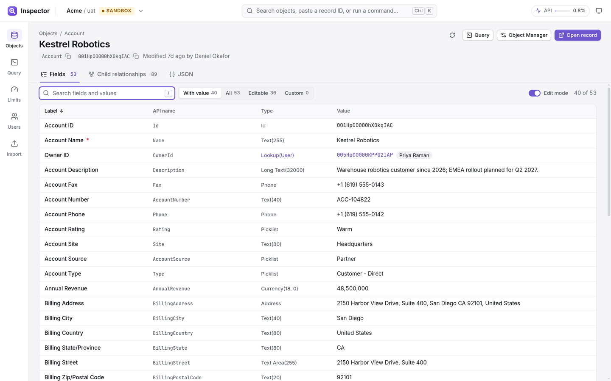
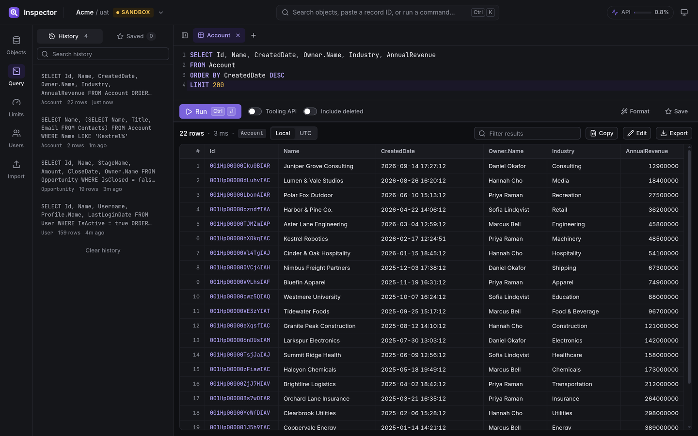
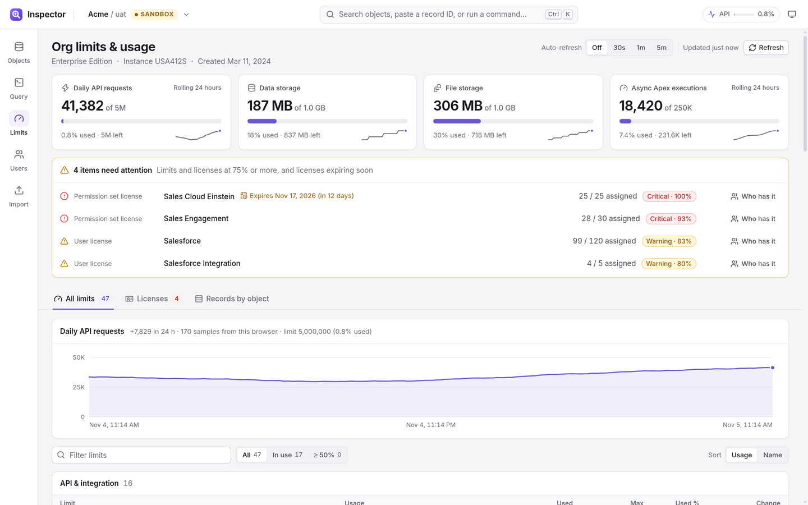
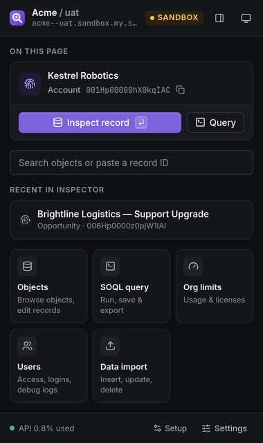
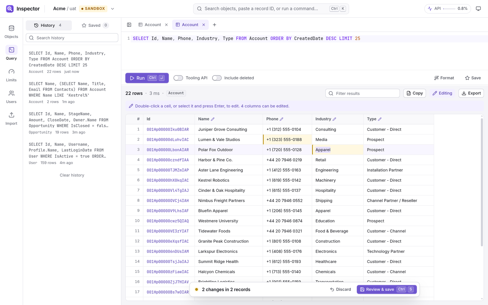
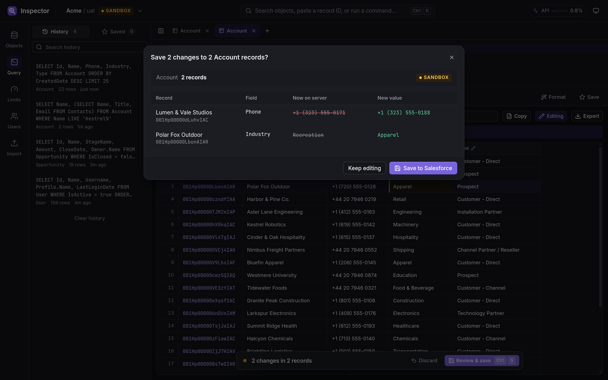
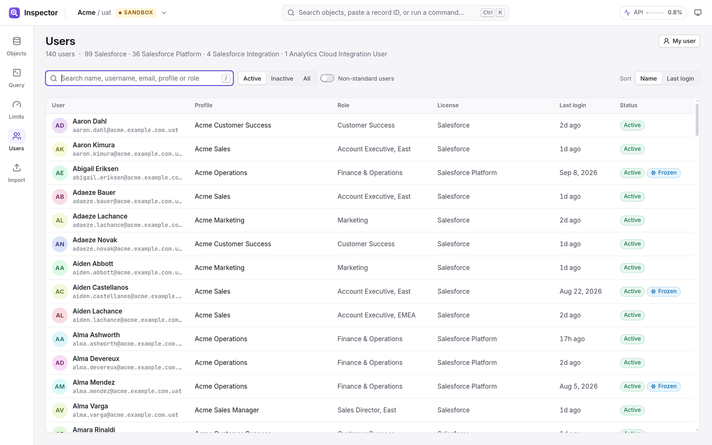
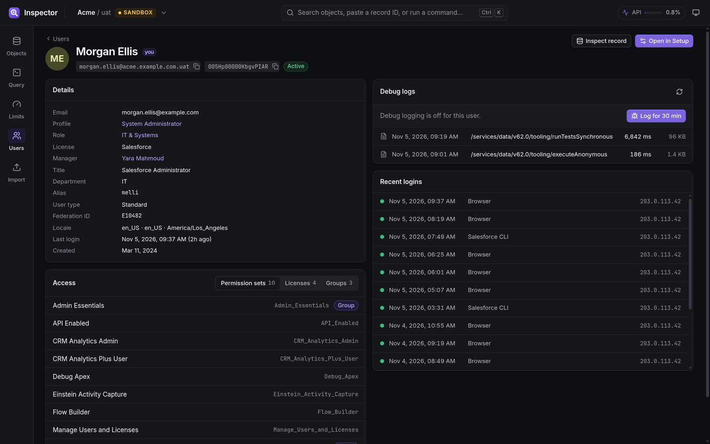
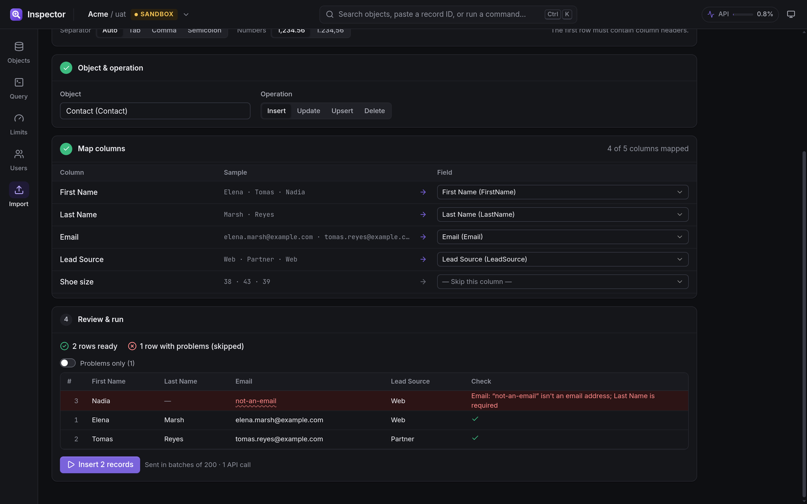
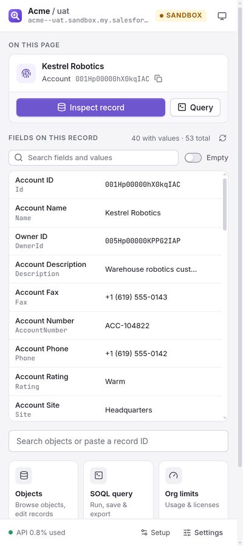

# Salesforce Inspector Enhanced

A Chrome extension for Salesforce admins and developers: inspect and edit any record, write and manage SOQL (and bulk edit its results), import data, look into users, and keep an eye on org limits. It has a modern UI with light and dark themes.

It uses your existing Salesforce browser session. There's nothing to configure and no connected app.

| Record inspector (light) | SOQL (dark) |
|---|---|
|  |  |
| **Org limits & licenses** | **Toolbar popup** |
|  |  |
| **Bulk edit in query results** | **Review before saving** |
|  |  |
| **Users** | **User detail & debug logs** |
|  |  |
| **Data import** | **Side panel** |
|  |  |

The screenshots and videos use a demo org with made-up people and companies. More screenshots are in [`docs/screenshots`](docs/screenshots). Short walkthroughs: [record inspector](docs/videos/record-inspector.mp4) · [SOQL](docs/videos/soql.mp4) ([dark](docs/videos/soql-dark.mp4)) · [limits](docs/videos/limits.mp4) · [command palette](docs/videos/palette.mp4).

## Features

### Objects & records
- Browse every object in the org. You can filter by standard, custom, custom metadata, settings or platform events, and jump straight to a record by pasting its ID.
- **Record view** lists all fields with their label, API name, type and value:
  - Lookups show the related record's name.
  - Id, Name, Record Type and Owner are pinned to the top.
  - Defaults to fields with a value, and search tells you when a match is hidden by the active filter.
- **Inline editing** with a type-aware editor for each field: picklists, multi-select, dates and times, numbers, lookups and long text.
  - Changes are staged and shown as *old → new*, then confirmed in a review dialog.
  - **Safety:** the review dialog re-reads the record and warns you if someone changed it since you loaded it. Every save shows a toast with **Undo**.
  - **Production orgs:** editing is locked until you turn on "Edit production data". The header gets a red edge and the save buttons say *production*.
- **Field details drawer** shows the full describe: formula, help text, picklist values, capabilities and raw JSON. It also has **Find records with this value**, which writes a correctly typed SOQL query for you.
- **Child relationships** with *Count all*, which batches the COUNT() queries through the Composite Batch API (25 per call). Record types and the raw JSON are on their own tabs.

### SOQL
- CodeMirror editor with SOQL highlighting and context-aware autocomplete:
  - object names after `FROM`
  - fields, matched by API name *or label*
  - relationship traversal (`Owner.Name`)
  - sub-query relationship names
  - picklist values, booleans and date literals after an operator
- Query tabs, history (per org) and saved queries (shared across orgs). Runs with the Tooling API or `queryAll` (include deleted records).
- Errors are underlined at the reported row/column.
- Virtualized results grid:
  - sort, column resize, row filter, keyboard navigation
  - drill into sub-query results
  - Ids link to the record view
- **Copy** puts the visible (filtered and sorted) rows on the clipboard as tab-separated text, ready for Excel (`Ctrl+Shift+C`). Export also offers CSV and JSON.
- **Bulk edit results:** turn on *Edit* to change cells in place (double-click or `Enter`), using the same type-aware editors as the record view.
  - Changes are staged per query tab and survive switching tabs. Re-running, closing the tab or leaving edit mode asks before discarding them.
  - **Review & save** (`Ctrl/⌘+S`) re-reads the records and shows what's on the server now next to each new value, highlighting anything that changed since the query ran.
  - Saves go through sObject Collections (200 records per call). Rows that fail stay staged with their error, and the failed list jumps to each row.

### Users
- Search users by name, username, email, profile or role, and filter by active / inactive or include portal, integration and automated users. Frozen users are marked. The filters are kept in the URL, so going back restores the list.
- **User detail:** profile, role, license, locale and last login, plus permission sets, permission set licenses, groups and queues, and recent login history.
- **Login as** (with the org's admin login-as setting), **Freeze / Unfreeze**, and links to the user in Setup and in the record inspector.
- **Debug logs:** turn on logging for a user for 30 minutes (`+30 min` extends it, up to 24 hours), see their recent Apex logs as they arrive, and read a log with line filtering, a "debug & errors only" view and download.

### Data import
- Paste rows from Excel or Google Sheets, drop a CSV, or choose a file. The separator is detected, and you pick the number format (`1,234.56` or `1.234,56`) so amounts are never guessed.
- **Insert, update, upsert** (on any external ID field) or **delete**. Columns are mapped to fields automatically by label or API name, and you can change or skip any of them.
- The preview checks every row before anything is sent: types, numbers, dates, emails, restricted picklists, required fields and missing IDs. Rows with problems are listed first and skipped.
- For update and upsert you choose whether blank cells leave fields unchanged or clear them. The confirmation says how many values would be cleared, and deletes or production imports need the action typed to confirm.
- Runs in batches of 200 through sObject Collections, with a progress bar and **Stop**. Results show every row's outcome, let you download them, query the created records, or run the rows that didn't get to run. Leaving the page while an import is running asks first.

### Org limits & usage
- KPI tiles for daily API requests, data and file storage, and async Apex.
- One **attention list** covers limits *and* user / permission set licenses at 75% or more, plus licenses that expire within 60 days.
- All `/limits` values grouped by category, with per-app breakdowns. Changes are tracked over time: every API call the extension makes records a usage sample, so the API trend fills in as you work.
- Licenses, and record counts by object (business data only, or everything).

### Everywhere
- **Toolbar popup** (pin the extension, or press `Alt+Shift+K`): this is the main entry point. It detects the record or object on the current Salesforce page and reuses the org's Inspector tab instead of opening new ones.
- **Side panel** (popup header button, `Alt+Shift+S`, or set the toolbar icon to open it): it stays open beside Salesforce, follows the active tab, and lists the current record's fields live. Search them, click an API name to copy it, or open a field in the inspector.
- **In-page launcher** (opt-in): a small tab on the right edge of Salesforce pages that opens the same popup as a floating panel. Turn it on with "In-page button" in the popup footer.
- **Command palette** (`Ctrl/⌘+K`):
  - objects, recent records, saved queries, Setup pages and theme
  - `Account.Industry` jumps to a field
  - `Ctrl+Enter` queries an object; `Shift+Enter` opens it in Object Manager
- **Keyboard shortcuts:**
  - `g` then `o` / `q` / `l` / `u` / `i` switches between Objects, Query, Limits, Users and Import
  - `/` focuses search
  - `Alt+E` toggles edit mode (in production it can only lock editing)
  - `Ctrl/⌘+S` reviews and saves
  - `Alt+Shift+K` opens the popup
  - `Alt+Shift+I` inspects the current page
  - `Alt+Shift+S` opens the side panel
  - The browser-level shortcuts can be changed at `chrome://extensions/shortcuts`.
- Light, dark or system theme. Text meets WCAG AA contrast in both themes, and every control is reachable from the keyboard.

## Install

1. Download `salesforce-inspector-enhanced-<version>.zip` from the [latest release](https://github.com/zlatio/salesforce-inspector-enahanced/releases/latest) and unzip it into a folder you'll keep. Chrome loads the extension from that folder.
2. Open `chrome://extensions`, enable **Developer mode**, click **Load unpacked** and select the folder.

To update, unzip the new release over the same folder and click the reload icon on the extension's card.

## Build from source

```bash
npm install
npm run build        # type-checks, then builds into dist/
```

Then load the `dist/` folder with **Load unpacked** as above.

`npm run build:fast` skips the type check. `npm run package` builds and zips `dist/` into `salesforce-inspector-enhanced-<version>.zip`, the file attached to each release. Bump `version` in both `package.json` and `public/manifest.json` before packaging a new release. After changing `assets/icon.svg`, run `node scripts/icons.mjs` (needs `rsvg-convert`) to regenerate the PNG icons.

## How it works

| Piece | Role |
|---|---|
| `src/background` | Service worker. Reads the `sid` session cookie (content scripts can't), maps Lightning hosts to the My Domain API host, and handles keyboard commands. |
| `src/content` | The in-page launcher, isolated in a shadow root. It opens the popup in an iframe panel. |
| `src/popup` | Toolbar popup and in-page panel. |
| `src/app` | The full-page app (`app.html?host=…#/inspect|query|limits|users|import`). |
| `src/lib/sf.ts` | REST client: Bearer session, cached describes, Composite Batch API, and `Sforce-Limit-Info` tracking. |
| `src/styles/tokens.css` | Design tokens. Every color comes from here, and light and dark are defined side by side. |

Built with Preact, Preact Signals, CodeMirror 6 and Vite. There are no runtime network calls other than to your own Salesforce org; see the [privacy policy](PRIVACY.md) for what's read and stored.

Inspired by [Salesforce Inspector Reloaded](https://github.com/tprouvot/Salesforce-Inspector-reloaded), which was used as a reference for the session/cookie approach. No code was copied.

## License

[MIT](LICENSE)
